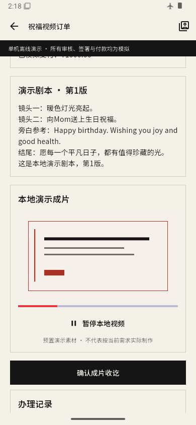

# Android 四组离线演示初版记录（历史）

本文记录0173a973初版APK当时的验证结果，以下“最终包”仅指初版阶段。后续机构名称修复包及追加原生验收见[当前报告](../android-offline-native-20261105/REPORT.md)。

四组流程已在独立本地分支实现，34项测试通过；最终APK在飞行模式下完成祝福视频全流程、本地视频播放与重启恢复。本次仍为模拟演示，实体Android设备验收和另一方审阅未进行。

## 安装包与版本

- 分支：`ux/android-offline-demo-20261105`。
- 基线：PR39 `0a0f856a1d00b40fdc086bb90004dad46c2fd193`。
- APK对应源码提交：`ac552448baf9f7daa52a4130cf95fe6dafa9f681`；之后只补验证脚本、证据和交付文档。
- 本机文件：`/Users/yanghaoran/Documents/Codex/2026-11-05/task/artifacts/archive/jingjing-android-offline-demo-0173a973.apk`。
- 名称“晶晶日上·离线演示”，应用标识 `com.jingjingshangri.jingjingshangri_app.offline`，与原App共存。
- Android 7.0／API24及以上，debug签名，208,535,855字节，支持arm64-v8a、armeabi-v7a、x86_64；本次实际运行arm64。
- SHA-256：`0173a973e4458f7eaa6170d51d4042fcb49d91547d13a32a7a29faa1cdbfb174`。已安装包与交付文件的校验值一致。

安装包保存在工作目录的artifacts中，没有加入Git。构建参数、校验值与机器可读结果见[BUILD.json](BUILD.json)、[VERIFICATION.json](VERIFICATION.json)。[使用与复跑说明](../../ANDROID_OFFLINE_DEMO_20261105.md)列出各账号的办理路线。

## 四组流程与验证层次

|流程|已实现的主要办理|本次证据|
|---|---|---|
|普通客户祝福视频|需求与素材、报价、约定、30/40/30模拟付款、剧本/样片/粗剪及反馈、成片播放、收讫|状态测试、页面组件测试、最终APK原生全流程|
|艺人形象、试镜、参演|资料编辑、本人展示授权与模拟审核；同笔试镜跨账号预约付款和交付确认；独立项目报名、筛选、本人约定与参演进度|状态与页面组件测试；原生全流程未逐条重跑|
|机构资料与成员|资料修改、邀请、成员接受、权限修改、移除及重新邀请|状态与页面组件测试；原生全流程未逐条重跑|
|出品方通告|草稿、提交、退回修改、模拟审核发布、艺人投稿、感兴趣/婉拒、客服跟进待办|状态与页面组件测试；原生全流程未逐条重跑|

共34项：12项离线状态测试、7项离线页面组件测试、15项既有导航/PR39入口回归。覆盖角色限制、创建重试、重复付款、写入失败回滚、排队动作身份固定、序列化、重置确认等。页面组件测试中的视频插件使用测试替身，实际媒体解码由下述原生检查另行证明。日志见[flutter-tests-final.log](flutter-tests-final.log)。新增Dart源码及测试分析无问题。

普通Android清单独立生成通过，原应用标识、名称和网络权限保留；离线APK没有INTERNET或ACCESS_NETWORK_STATE权限，离线入口也拒绝Dart网络请求。构建与权限证据见[android-build-final.log](android-build-final.log)、[apk-permissions.txt](apk-permissions.txt)、[standard-manifest.log](standard-manifest.log)。未以普通清单生成冒称普通APK完整构建。

## 最终包原生检查

新建隔离AVD `JX_OFFLINE_DEMO`，序列号 `emulator-5580`，Android 15／API35，390×844测试显示尺寸。首次安装前启用飞行模式，本次检查结束仍为飞行模式；原 `emulator-5554` 和旧业务会话未操作。工具链、依赖、系统镜像均来自本机已有安装或缓存，没有安装新软件。

通过真实页面输入、点击和滚动完成新订单 `orders-15`，本地样片与成片均实际播放，最终状态为 `received`。只读SQLite证实三笔模拟付款分别为首款30,000分、中期40,000分、尾款30,000分，没有通过数据库注入跳过步骤。事件见[blessing-result.json](blessing-result.json)，执行日志见[native-blessing-final.log](native-blessing-final.log)。

随后强制停止并重新打开离线App。等待实际主页可操作后，比较重启前后持久化内容，结果完全相同：当前客户身份、两笔既有测试订单、六笔模拟付款及其余状态全部保留。第二笔是最终APK新走通的订单，第一笔为此前检查记录，没有清空。见[restart-result.json](restart-result.json)、[native-restart-final.log](native-restart-final.log)、[native-device.json](native-device.json)。私有数据库和完整业务快照仅保存在本机证据目录，没有加入Git。

|断网本地成片播放|重启后的主页与已收讫订单|
|---|---|
|||

初期遇到并处理的验证问题：新AVD首次启动System UI无响应，降低显示尺寸后可运行；早期原生脚本误把历史付款文本当成按钮，已限制匹配可点击控件，并在最终APK从新订单完整复跑；首次重启脚本在Flutter界面树尚未准备好时失败，实际App随后正常出现，脚本改为等待主页后重新验证通过。这些早期失败不计为通过，最终结果只取上述复跑证据。

## 尚未发生的验收与交付

前端负责人Bill-Billion已交付本机实现与检查记录，下一步可交实体Android设备体验；另一方对Android构建配置的实际审阅仍待进行。文件导入选择器在实体设备上的权限、机型差异和所有流程的原生逐页检查尚未验收。后端负责人chengcongcong222继续原线上正式能力和待核边界计划，本次不新增服务器接口依赖，也未代其认领或审阅。

原18组、12路线、151条正式验收不因此关闭；沿用原盘点的0组正式关闭、151条未结案、82条局部证据，未重跑全套线上验收。现有7类正式能力缺口和3类待核边界不属于此离线包已完成范围。付款、审核和签约均为模拟，视频是预置示意素材。

仅保存本地提交，未推送远端、合并或部署。本次没有权限拒绝或连接阻塞；用户体验离线包无需提供服务器、密钥或补充合同资料。
